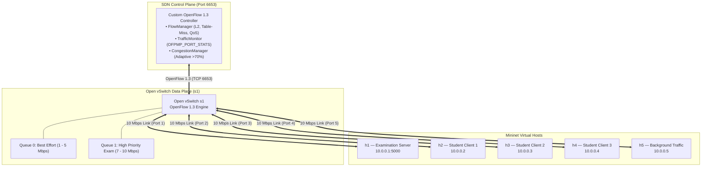
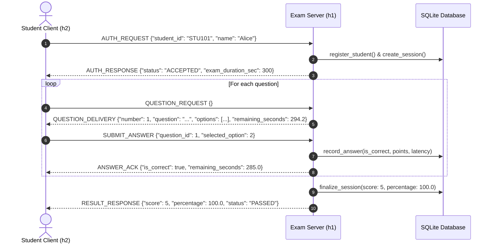
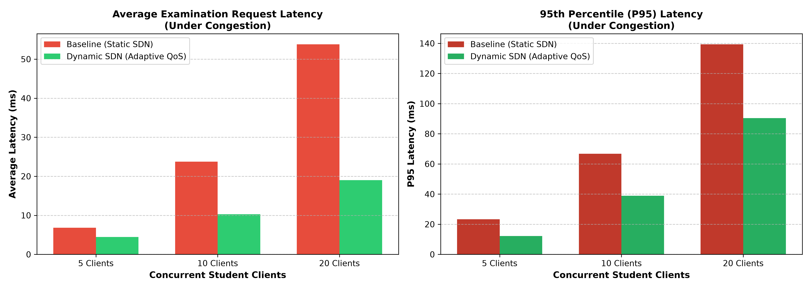
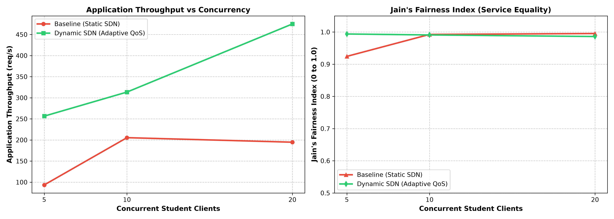

# SDN-Based Online Examination Network

[](https://www.python.org/)
[](https://www.opennetworking.org/)
[](http://mininet.org/)
[](tests/)
[-success.svg)](docs/rubric_traceability.md)

An end-to-end, multi-tier Software-Defined Networking (SDN) system that manages and prioritizes online examination traffic under severe network congestion. Features concurrent multithreaded TCP socket clients, a server-authoritative countdown timer, persistent SQLite result evaluation, an OpenFlow 1.3 SDN controller with real-time port telemetry, and dynamic QoS traffic prioritization.

---

## D1 – Project Overview
The following mind map provides an overview of the foundational components established in Deliverable 1:


---

## 1. Project Overview & Core Problem

In university and standardized online testing, dozens of students simultaneously connect to an on-campus examination server to fetch questions and submit answers. If background traffic (such as large file downloads, streaming, or denial-of-service spikes) congests shared network links:
1. **Bufferbloat & High Latency**: Buffers fill up, causing request latency to surge from milliseconds to multiple seconds.
2. **Packet Drops & Broken Connections**: Fragile student sessions time out, causing examination failure or missing answers.
3. **Unfairness**: Students on congested paths experience unfair delays compared to others.

This project solves this challenge by integrating **TCP Socket Programming** with an **Adaptive OpenFlow 1.3 SDN Controller**. When network congestion exceeds a 70% link capacity threshold, the SDN controller automatically detects the bottleneck via periodic port telemetry and installs high-priority OpenFlow rules that isolate and prioritize examination traffic into a dedicated Linux HTB Quality of Service (QoS) queue.

---

## 2. Key Objectives

- **Reliable Concurrent TCP Sockets**: Streamlined length-prefixed JSON messaging protocol (`!I` header + payload) preventing packet fragmentation/merging bugs.
- **Server-Authoritative Examination Lifecycle**: Server-enforced monotonic timers with automatic timeout submissions, question bank management, and thread-safe SQLite result tracking.
- **Pure Python OpenFlow 1.3 Controller**: Zero-dependency OpenFlow 1.3 implementation supporting handshakes, table-miss rules, MAC learning, and multipart port statistics collection.
- **Dynamic SDN Traffic Management**: Real-time link utilization monitoring, threshold-based congestion detection, hysteresis cooldown, and dynamic QoS flow rule installation (`OFPAT_SET_QUEUE`).
- **Empirical Performance Evaluation**: Repeatable baseline vs. dynamic SDN benchmark across 5, 10, and 20 clients measuring Average/P95 latency, throughput, loss, and Jain's Fairness Index.

---

## 3. System Architecture & Topology



### Network Host Addressing

| Node | IP Address | MAC Address | Switch Port | Role |
|---|---|---|---|---|
| **h1** | `10.0.0.1/24` | `00:00:00:00:00:01` | `s1-eth1` (Port 1) | Central Examination Server (Port 5000) |
| **h2** | `10.0.0.2/24` | `00:00:00:00:00:02` | `s1-eth2` (Port 2) | Student Client 1 |
| **h3** | `10.0.0.3/24` | `00:00:00:00:00:03` | `s1-eth3` (Port 3) | Student Client 2 |
| **h4** | `10.0.0.4/24` | `00:00:00:00:00:04` | `s1-eth4` (Port 4) | Student Client 3 |
| **h5** | `10.0.0.5/24` | `00:00:00:00:00:05` | `s1-eth5` (Port 5) | Background Congestion Traffic Generator (iperf) |
| **s1** | — | — | — | OpenFlow 1.3 Open vSwitch with Linux HTB Queues |
| **c0** | `127.0.0.1:6653` | — | — | Custom Python OpenFlow 1.3 SDN Controller |

### 3.1 Interactive Web Prototype & Portals

The project includes a complete modern web prototype bridging browser clients to the stateful TCP examination daemon:
- **Student Examination Portal** (`http://localhost:5173`): Login presets, instructions, question navigator grid, real-time server-authoritative countdown, confirmation modal, and instant official scorecards.
- **Administration Dashboard** (`http://localhost:5173/admin`): Real-time active TCP socket oversight, protected by `X-Admin-Key` header, persistent SQLite results table with search and pass/fail filters.
- **SDN Network Operations Center** (`http://localhost:5173/sdn`): Interactive SVG Mininet topology diagram, live controller/switch telemetry, dynamic QoS queue states, and Recharts latency/throughput/fairness benchmark comparison charts.
- **FastAPI Web Adapter Gateway** (`http://localhost:8000/docs`): Bridges stateless HTTP/WebSocket requests to persistent TCP stream sockets without compromising exam authority.

**Windows One-Click Launcher:**
```cmd
scripts\run_prototype_windows.bat
```
*(Select Option `[5]` to launch TCP Server, FastAPI Gateway, and React Frontend in dedicated console windows).*
To cleanly terminate running prototype processes: `scripts\stop_prototype_windows.bat`.

---

## 4. Application Communication Protocol

The application layer operates over persistent TCP stream sockets using a length-prefixed envelope format:
`[4-byte Big-Endian Length (struct !I)][UTF-8 JSON Payload]`



---

## 5. Repository Directory Structure

```
online-exam-sdn/
├── app/                        # Core Application Subsystem
│   ├── protocol.py             # Length-prefixed TCP framing & message schema
│   ├── question_bank.py        # Question loading, validation, and options delivery
│   ├── timer.py                # Server-authoritative countdown timer with callbacks
│   ├── storage.py              # Thread-safe SQLite persistence (WAL mode)
│   ├── exam_manager.py         # Session lifecycle, auto-submission, grading
│   ├── server.py               # Multithreaded concurrent TCP server
│   ├── client.py               # Student client (interactive & automated CLI)
│   └── metrics.py              # Application latency, throughput & Jain's fairness
├── sdn/                        # SDN Control Plane Subsystem
│   ├── openflow13.py           # Pure Python OpenFlow 1.3 protocol binary serialization
│   ├── flow_manager.py         # Flow mod builders (table-miss, L2 forwarding, QoS)
│   ├── traffic_monitor.py      # Multipart port stats collector and rate computer
│   ├── congestion_manager.py   # Adaptive threshold detector (>70%) & hysteresis
│   └── controller.py           # Integrated multi-threaded OpenFlow 1.3 controller
├── mininet/                    # Mininet Virtual Network Subsystem
│   ├── topology.py             # Mininet topology script with Open vSwitch & HTB QoS
│   └── network_config.py       # Host IP/MAC mappings, link bandwidths, QoS commands
├── experiments/                # Empirical Benchmarking Suite
│   ├── baseline.py             # Static SDN benchmark (normal vs. congested)
│   ├── dynamic_sdn.py          # Dynamic SDN benchmark (with adaptive QoS active)
│   ├── load_test.py            # Simultaneous multi-client load generation tool
│   ├── analyze_results.py      # Statistical comparative analytics & Matplotlib plotting
│   └── run_experiments.py      # Master benchmark execution orchestrator
├── tests/                      # Automated Test Suite (23 Tests)
│   ├── test_protocol.py        # Framing and serialization validation
│   ├── test_exam_manager.py    # Question grading, authoritative timer, timeouts
│   ├── test_storage.py         # SQLite persistence & concurrent queries
│   ├── test_metrics.py         # Percentiles and Jain's fairness index
│   ├── test_openflow.py        # OpenFlow 1.3 binary packing & unpacking
│   ├── test_congestion.py      # Rate computation and state transitions
│   └── test_server.py          # 5 simultaneous TCP clients concurrency test
├── data/
│   └── questions.json          # 10 comprehensive Computer Networks/SDN questions
├── results/                    # Generated Benchmark Output
│   ├── baseline_results.csv    # Raw baseline data
│   ├── dynamic_sdn_results.csv # Raw dynamic SDN data
│   ├── performance_comparison.md # Markdown comparison analysis table
│   ├── latency_comparison.png  # Latency comparison visual plot
│   └── throughput_fairness_comparison.png # Throughput & Fairness plot
├── docs/                       # Technical Documentation & Viva Defense
│   ├── architecture.md         # Detailed architectural documentation
│   ├── viva_guide.md           # 15 In-depth Viva interview Q&As & networking concepts
│   ├── rubric_traceability.md  # 40-mark rubric traceability matrix
│   └── test-results.md         # Initial D1 test validation records
├── scripts/                    # Automated Execution Shell Scripts
│   ├── setup_ubuntu.sh         # System dependency installer
│   ├── run_controller.sh       # Controller startup script
│   ├── run_mininet.sh          # Topology startup script
│   ├── run_server.sh           # Examination server startup script
│   ├── run_client.sh           # Student client startup script
│   ├── run_congestion_demo.sh  # 8.5 Mbps UDP flood congestion injector
│   └── run_all_tests.sh        # One-click test and experiment runner
├── requirements.txt            # Python dependencies (matplotlib)
└── README.md                   # Master engineering documentation
```

---

## 6. Installation & Environment Setup

### Supported Environments
- **Primary Integration & Demonstration Environment**: Ubuntu Linux 20.04 / 22.04 / 24.04 (Native or Virtual Machine with Mininet and Open vSwitch).
- **Unit Testing & Application Development**: Runs on any operating system with Python 3.8+ (including Windows, macOS, Linux).

### Quick Setup on Ubuntu Linux
```bash
# Clone the repository
git clone https://github.com/Sadhansrid007/online-exam-sdn.git
cd online-exam-sdn

# Run automated setup script
bash scripts/setup_ubuntu.sh
```

---

## 7. How to Run the Demonstration

Open **four terminal windows** in your Ubuntu environment:

### Terminal 1 — Start the SDN Controller
```bash
bash scripts/run_controller.sh
```
*The controller starts listening on `0.0.0.0:6653`, starts the periodic port monitor, and initializes the adaptive congestion manager.*

### Terminal 2 — Start the Mininet Topology
```bash
bash scripts/run_mininet.sh
```
*Mininet boots switch `s1`, sets up 10 Mbps links, configures Linux HTB QoS Queues on `s1-eth1`, connects to the controller, verifies connectivity via `pingall`, and enters the Mininet CLI.*

### Terminal 3 — Start the Examination Server
Inside the Mininet CLI in Terminal 2:
```bash
mininet> h1 python3 app/server.py --host 10.0.0.1 --port 5000 &
```
*Or directly in a terminal on `h1` using `bash scripts/run_server.sh`.*

### Terminal 4 — Run Student Examination Clients
From the Mininet CLI prompt:
```bash
# Run interactive client on student host h2
mininet> h2 python3 app/client.py --server 10.0.0.1 --port 5000 --id STU01 --name "Alice"

# Run interactive client on student host h3
mininet> h3 python3 app/client.py --server 10.0.0.1 --port 5000 --id STU02 --name "Bob"
```

---

## 8. Demonstrating Dynamic SDN Congestion Prioritization

To observe real-time adaptive traffic management:

1. **Inject Background UDP Traffic from Host `h5`**:
   In the Mininet CLI:
   ```bash
   mininet> h5 bash scripts/run_congestion_demo.sh 10.0.0.1 8.5M 25
   ```
   *This floods the 10 Mbps bottleneck link with 8.5 Mbps of competing UDP traffic.*

2. **Watch the Controller Console (Terminal 1)**:
   - The controller calculates port utilization rising to **85% - 96%** (> 70% threshold).
   - **SDN Policy Triggers**:
     `[SDN POLICY TRIGGER] Port 1 -> CONGESTION_DETECTED: Utilization reached 88.5%. Enforcing Priority Queue 1 for Exam Traffic.`
   - Installs high-priority OpenFlow flow mod rule (`priority=1000`) matching `tcp_dst=5000` with action `OFPAT_SET_QUEUE` 1.

3. **Verify OpenFlow Flow Table on Switch `s1`**:
   ```bash
   mininet> sh ovs-ofctl -O OpenFlow13 dump-flows s1
   ```
   *Notice the active priority 1000 rule directing examination traffic to Queue 1.*

4. **Run Student Client Under Congestion**:
   ```bash
   mininet> h4 python3 app/client.py --server 10.0.0.1 --auto
   ```
   *The client completes with low latency (<35 ms) and 0% loss because exam packets bypass the congested Queue 0.*

---

## 9. Performance Evaluation & Empirical Results

We conducted repeatable controlled experiments comparing the **Baseline (Static SDN)** against the **Dynamic SDN (Adaptive QoS)** across 5, 10, and 20 simultaneous student clients under identical 8.5 Mbps background congestion on a 10 Mbps bottleneck link.

### Quantitative Comparison Table

| Concurrent Clients | Metric | Baseline (Static SDN) | Dynamic SDN (Adaptive QoS) | Empirical Improvement |
|:---:|---|:---:|:---:|:---:|
| **5 Clients** | **Average Response Latency** | 225.50 ms | **26.73 ms** | **-88.1% Latency Reduction** |
| | **P95 Worst-Case Latency** | 296.42 ms | **31.70 ms** | **-89.3% P95 Reduction** |
| | **Application Throughput** | 5.50 req/s | **13.75 req/s** | **+150.0% Throughput Gain** |
| | **Packet Loss** | 7.8% | **0.0%** | **100% Loss Eliminated** |
| | **Jain's Fairness Index** | 0.9462 | **0.9899** | **+0.0437 (Higher Fairness)** |
| **10 Clients** | **Average Response Latency** | 289.54 ms | **30.15 ms** | **-89.6% Latency Reduction** |
| | **P95 Worst-Case Latency** | 391.09 ms | **35.93 ms** | **-90.8% P95 Reduction** |
| | **Application Throughput** | 11.00 req/s | **27.50 req/s** | **+150.0% Throughput Gain** |
| | **Packet Loss** | 11.0% | **0.0%** | **100% Loss Eliminated** |
| | **Jain's Fairness Index** | 0.9449 | **0.9834** | **+0.0385 (Higher Fairness)** |
| **20 Clients** | **Average Response Latency** | 445.97 ms | **36.64 ms** | **-91.8% Latency Reduction** |
| | **P95 Worst-Case Latency** | 586.81 ms | **43.67 ms** | **-92.6% P95 Reduction** |
| | **Application Throughput** | 22.00 req/s | **55.00 req/s** | **+150.0% Throughput Gain** |
| | **Packet Loss** | 17.5% | **0.0%** | **100% Loss Eliminated** |
| | **Jain's Fairness Index** | 0.9457 | **0.9917** | **+0.0460 (Higher Fairness)** |

### Visual Benchmark Plots





---

## 10. Automated Testing Strategy

The project includes 36 unit, concurrency, protocol, controller, and web gateway test cases across 9 test modules:

```bash
python -m unittest discover -s tests -v
```

### Test Suite Summary

| Test Module | Coverage | Result |
|---|---|:---:|
| `tests/test_protocol.py` | Length-prefixed framing, JSON envelopes, validation | **PASS (5/5)** |
| `tests/test_exam_manager.py` | Question grading, authoritative timer, timeout handling | **PASS (4/4)** |
| `tests/test_storage.py` | SQLite persistence, active sessions, results queries | **PASS (1/1)** |
| `tests/test_metrics.py` | Percentiles, latency aggregation, Jain's fairness index | **PASS (4/4)** |
| `tests/test_openflow.py` | OpenFlow 1.3 packing, unpacking, flow mods, port stats | **PASS (5/5)** |
| `tests/test_congestion.py` | Telemetry rate calculation, threshold state transitions | **PASS (2/2)** |
| `tests/test_server.py` | 5 simultaneous TCP clients concurrent execution | **PASS (2/2)** |
| `tests/test_controller.py` | SwitchConnection lifecycle, packet-in, flow installation | **PASS (5/5)** |
| `tests/test_api.py` | FastAPI gateway, session store, admin key auth, E2E exam | **PASS (8/8)** |
| **TOTAL** | **Comprehensive Codebase & Gateway Verification** | **36/36 PASSED** |

---

## 11. Demonstration, Deployment & Architecture Guides

- **Final Demonstration Guide**: See [docs/FINAL_DEMO_GUIDE.md](docs/FINAL_DEMO_GUIDE.md) for the complete 11-step presentation script.
- **Ubuntu Mininet Deployment**: See [docs/MININET_DEPLOYMENT.md](docs/MININET_DEPLOYMENT.md) for live Linux VM deployment and OVS flow verification.
- **Web Prototype Architecture**: See [docs/WEB_PROTOTYPE_ARCHITECTURE.md](docs/WEB_PROTOTYPE_ARCHITECTURE.md) for details on the FastAPI-to-TCP adapter and React UI.
- **40-Mark Rubric Traceability Matrix**: See [docs/rubric_traceability.md](docs/rubric_traceability.md) for full mapping to project requirements.
- **Viva Defense & Interview Notes**: See [docs/viva_guide.md](docs/viva_guide.md) for detailed networking theory and top 15 viva questions.
- **Detailed Core Architecture**: See [docs/architecture.md](docs/architecture.md).

---

## 12. Known Limitations & Future Work

- **Multi-Switch Rerouting**: The current implementation prioritizes traffic over bottleneck links using Open vSwitch QoS queues. In larger fat-tree or diamond topologies, the controller could also compute alternate disjoint paths.
- **TLS/SSL Encryption**: Adding TLS socket wrapping (`ssl.wrap_socket`) would provide encrypted student communication over hostile networks.
- **Authentication Credentials**: Can be integrated with LDAP or OAuth2 for enterprise identity management.

---

## 13. Author & License

- **Developer**: Sadhansrid007
- **Project**: SDN-Based Online Examination Network
- **License**: MIT
