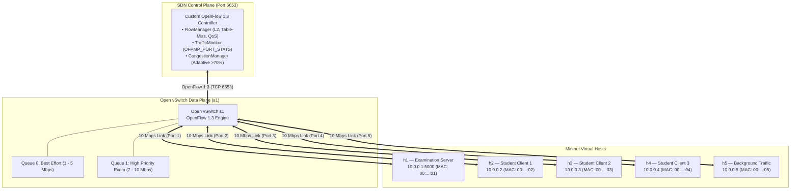
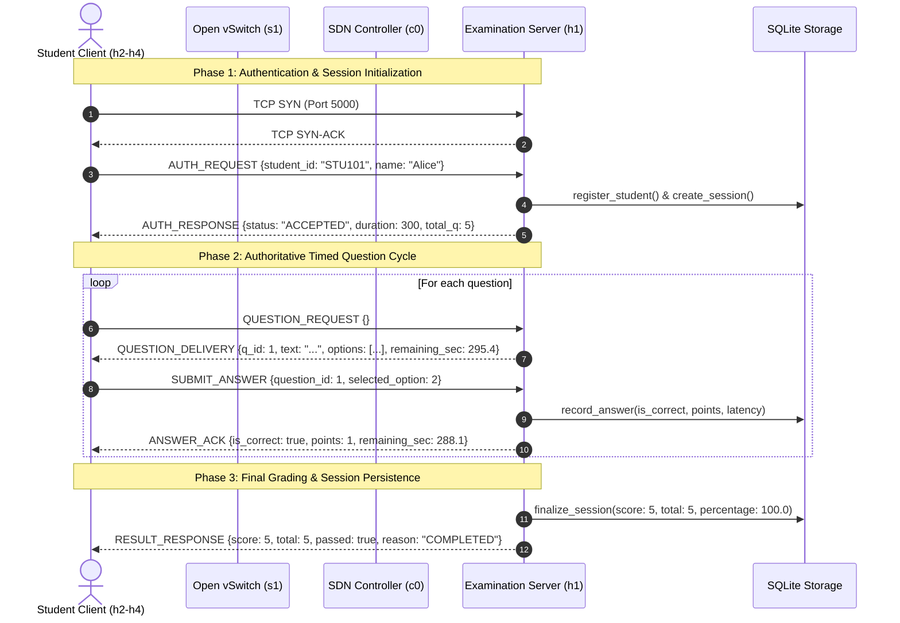
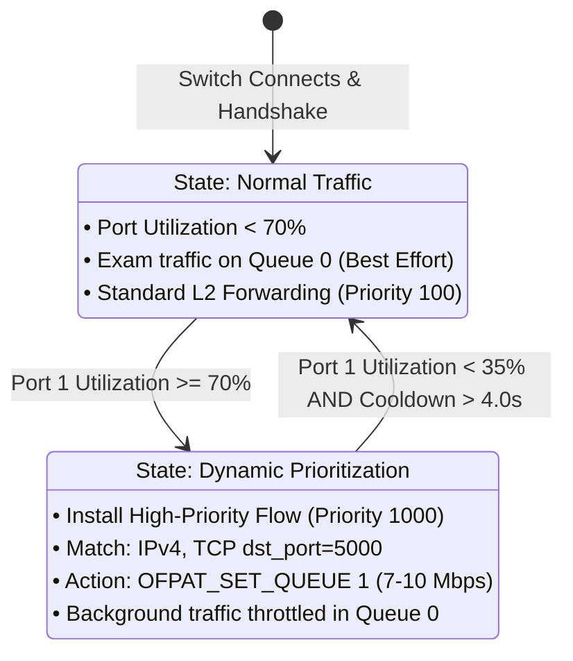

# System and Network Architecture
## SDN-Based Online Examination Network

This document details the complete end-to-end architecture, communication flows, OpenFlow control plane interactions, and Quality of Service (QoS) enforcement mechanisms.

---

## 1. Physical and Logical Network Topology

The network consists of an OpenFlow 1.3 Open vSwitch (`s1`) connected to five Mininet virtual hosts and managed by an external custom Python OpenFlow 1.3 SDN Controller (`c0`).

---

## 2. Application Layer Communication Flow

The TCP application uses length-prefixed JSON framing (`!I` header + UTF-8 payload) over persistent TCP stream sockets.

---

## 3. Dynamic SDN Congestion Management Workflow

The SDN controller monitors port statistics in real-time and dynamically enforces Quality of Service (QoS) queues when background congestion threatens examination traffic.

---

## 4. Layer Responsibility Matrix

| Subsystem | Component | Key Responsibilities |
|---|---|---|
| **Application Layer** | `app.protocol` | Length-prefixed binary framing, JSON serialization, envelope validation |
| | `app.question_bank` | Question parsing, option randomization, grading explanations |
| | `app.timer` | Server-authoritative monotonic deadline tracking, auto-submission callbacks |
| | `app.storage` | Thread-safe SQLite persistence for students, sessions, answers, and scores |
| | `app.exam_manager` | Session state coordinator, timeout dispatcher, grade calculator |
| | `app.server` & `app.client` | Multi-threaded TCP server and interactive/automated student clients |
| **SDN Control Plane** | `sdn.openflow13` | OpenFlow 1.3 protocol binary packing and unpacking |
| | `sdn.flow_manager` | Table-miss, learned L2, and dynamic QoS flow mod generation |
| | `sdn.traffic_monitor` | Periodic polling of port counters, throughput & utilization calculation |
| | `sdn.congestion_manager` | Adaptive threshold detection, hysteresis cooldown, policy decision logging |
| | `sdn.controller` | Central OpenFlow listener, connection registry, policy dispatcher |
| **Data Plane / Mininet**| `mininet.topology` | Mininet network orchestration, 10 Mbps links, Open vSwitch configuration |
| | `mininet.network_config` | Network addressing, MAC mapping, Linux HTB QoS queues |
| **Benchmarking Suite** | `experiments.baseline` | Evaluates static SDN under normal and congested traffic |
| | `experiments.dynamic_sdn` | Evaluates dynamic SDN adaptive QoS prioritization |
| | `experiments.analyze_results`| Computes Jain's Fairness Index, latency percentiles, and Matplotlib plots |
